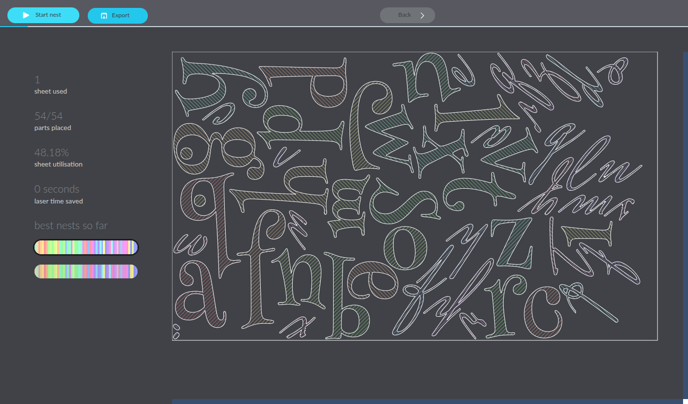
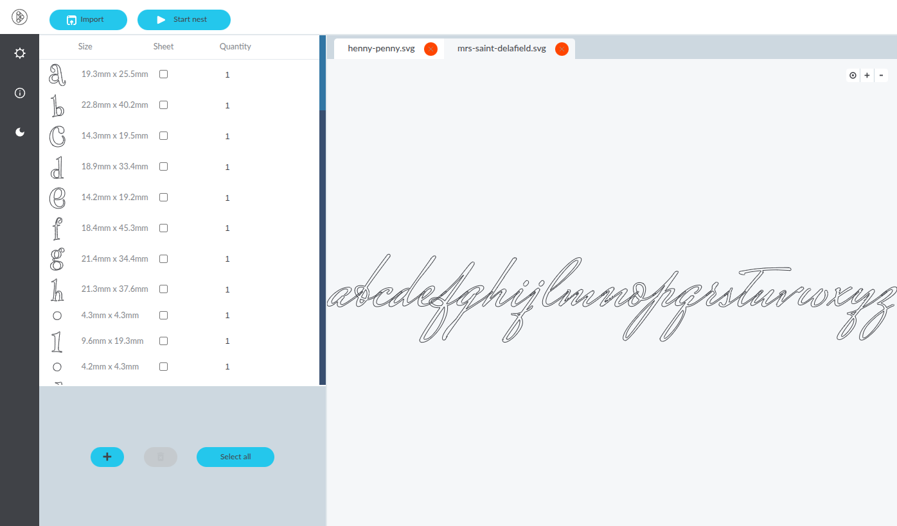
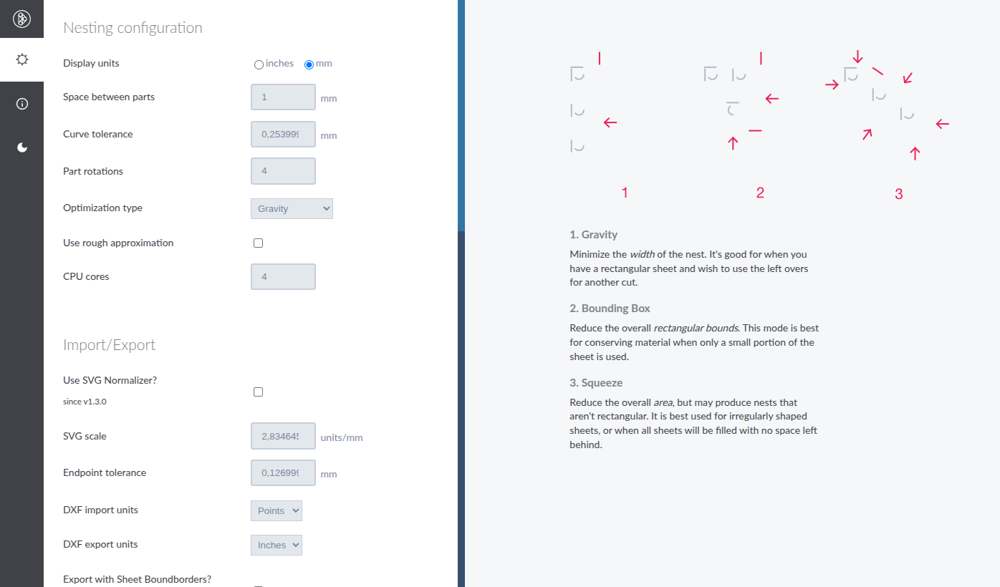

  

<h3 align="center">Free, open source nesting software for laser, plasma, waterjet and CNC cutting</h3>

  
  
  
  

---

**deepnest** arranges your parts on sheet material so that as little as possible ends up as scrap.
Load your SVG or DXF drawings, set the sheet size, press **Start nest**, and export a cut-ready layout
for your laser cutter, plasma table, router, plotter or vinyl cutter.

It runs on your own computer (Windows, macOS, Linux), costs nothing, and is free for commercial use.

  <picture>
    <source media="(prefers-color-scheme: dark)" srcset="docs/screenshots/nest-dark.png">
    
  </picture>
   
  54 irregular parts nested on one 185 × 110 mm sheet in a few seconds.

## Who it is for

- **Workshops and manufacturers**: nest sheet metal, wood, acrylic or textiles for production jobs and cut material costs.
- **Makerspaces and hobbyists**: fit more parts on one sheet of plywood or acrylic for your laser cutter or CNC router.
- **Sign makers, garment and leather work**: arrange irregular shapes such as letters, patterns and templates.
- **Anyone** who needs a free alternative to commercial nesting software for 2D irregular shapes, not just rectangles.

## Features

- **True-shape nesting**: parts are packed by their real outline, not their bounding box. Small parts can go into the holes of bigger ones.
- **Keeps improving**: a genetic algorithm keeps searching for better layouts while you watch. Stop whenever the result is good enough.
- **Three optimization modes**: *Gravity* (keeps the nest narrow, so the leftover strip stays usable), *Bounding box* (smallest rectangular area) and *Squeeze* (smallest overall area, for irregular sheets or no leftovers).
- **Part rotations**: try 4, 8, 16 or more rotation angles per part, up to 360 (experimental).
- **Common-line merging**: shared edges between neighbouring parts are cut once. Less cutting time, less wear on the machine.
- **Spacing control**: set the gap between parts for kerf, bridges or clamping.
- **Quantities**: set how many of each part you need, or read the count straight from the file name (`bracket.{quantity:5}.svg`).
- **Multiple sheets**: add as many sheets of any size as you need, and deepnest fills them one after another.
- **Presets**: save and reload your settings per material or machine.
- **Fast native core**: the geometry engine (no-fit polygons) is written in C++ and runs on all your CPU cores.
- **mm or inch**, light and dark mode.

## Screenshots

| Import parts and set quantities | Tune the nesting settings |
|---|---|
|  |  |

## File formats

| Import | Export |
|---|---|
| SVG, EPS, PS | SVG |
| DXF, DWG (via conversion service) | DXF |
| | PLT (HPGL) for plotters and cutters |
| | JSON (placement data for your own tools) |

## Download

Get the latest version from the **[releases page](https://github.com/deepnest-next/deepnest/releases/latest)**:

| System | File |
|---|---|
| Windows (x64) | `deepnest-vX.Y.Z-win32-x64.zip` |
| macOS (Apple Silicon / Intel) | `deepnest-vX.Y.Z-mac-arm64.dmg` / `deepnest-vX.Y.Z-mac-x64.dmg` |
| Linux (x64 / arm64) | `deepnest-vX.Y.Z-linux-x64.zip` / `deepnest-vX.Y.Z-linux-arm64.zip` |

## Quick start

1. **Import** your parts (SVG or DXF). Each closed outline becomes one part.
2. Set the **quantity** for each part.
3. **Add a sheet** with the size of your material.
4. Check the **settings**: units, spacing, rotations, optimization type.
5. Press **Start nest** and watch the layout improve. Press **Stop nest** when you are happy.
6. **Export** the result as SVG, DXF or PLT and send it to your machine.

## What's next

deepnest 2.0 is in development: a new nesting engine written in Rust, native DXF import without the
online conversion service, and loading whole nesting projects from CSV or JSON.

## Community and support

- Questions, ideas, show your nests: [Discord](https://discord.gg/z8CjG94PYk)
- Bugs and feature requests: [GitHub issues](https://github.com/deepnest-next/deepnest/issues)
- Support the project: [GitHub Sponsors](https://github.com/sponsors/deepnest-next) or [Patreon](https://patreon.com/deepnest_next)

## Build from source

See the [build docs](BUILD.md).

## License

deepnest is released under the [MIT license](LICENSE). Third-party licenses are listed in [LICENSES.md](LICENSES.md).
